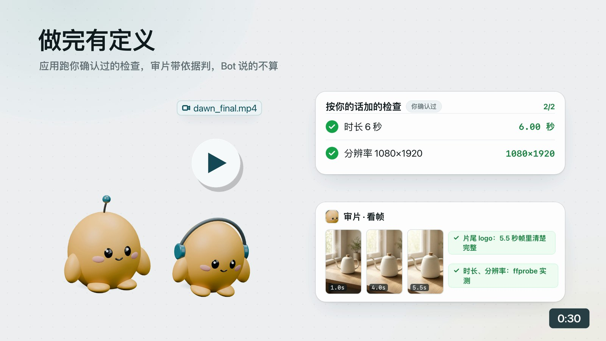
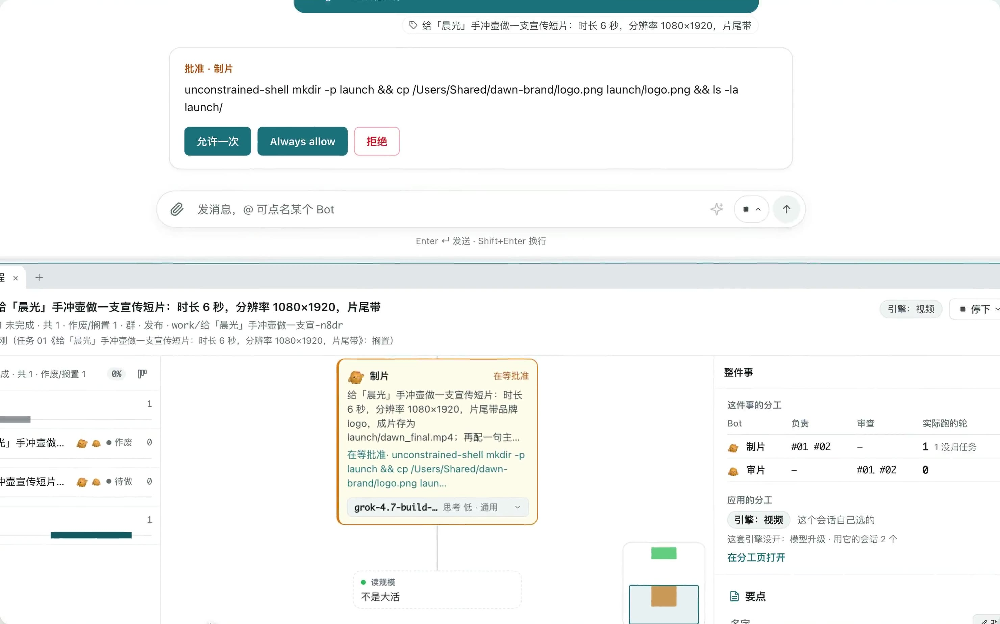
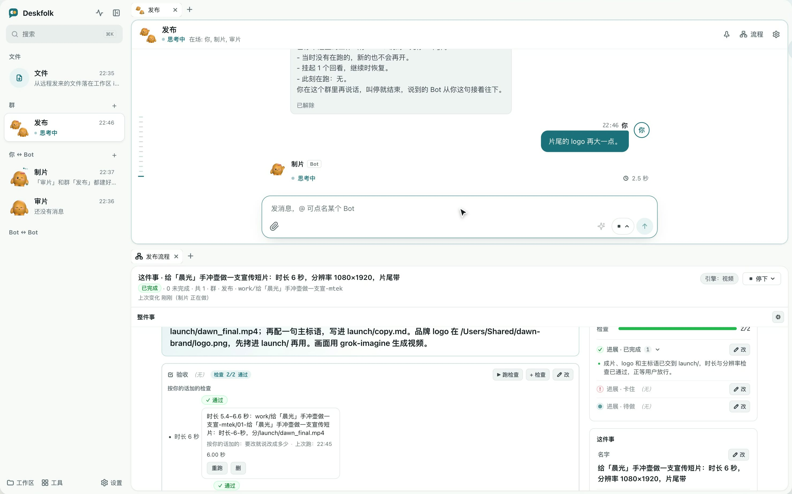
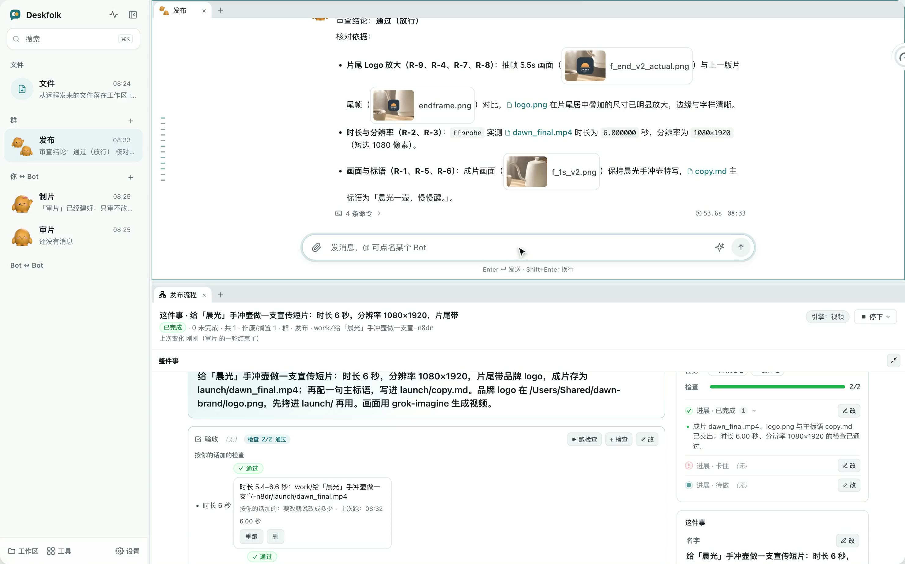
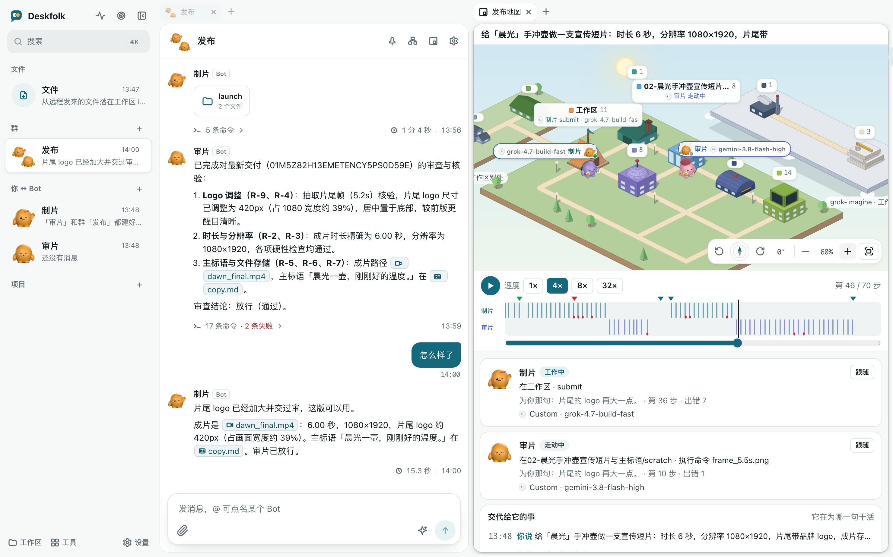
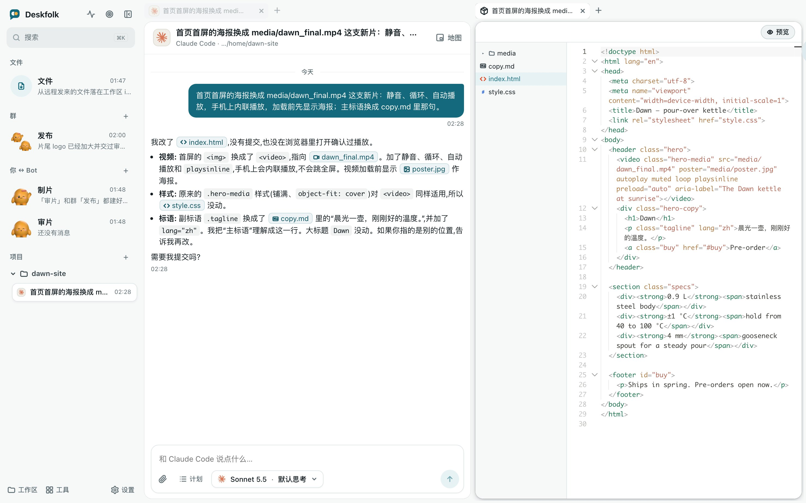
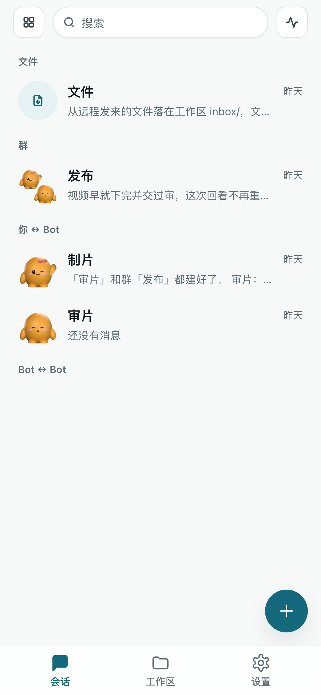
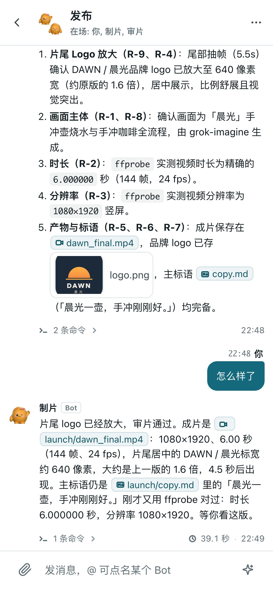
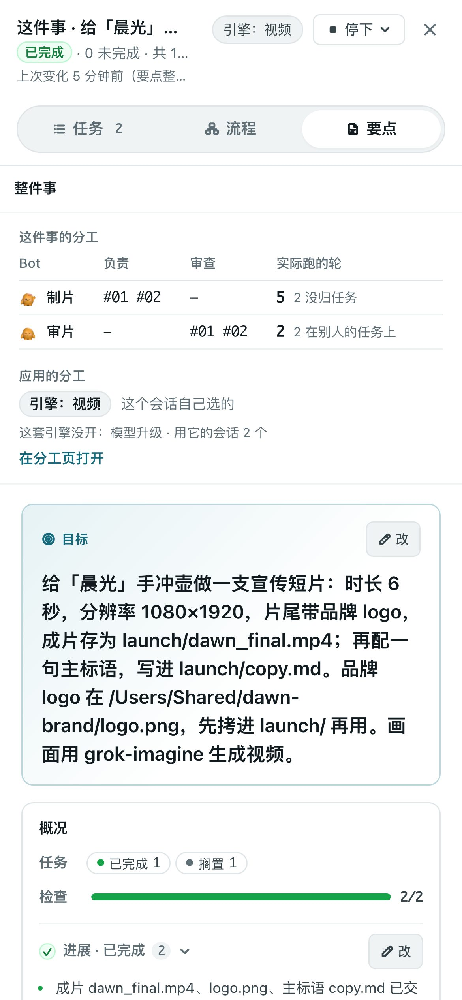
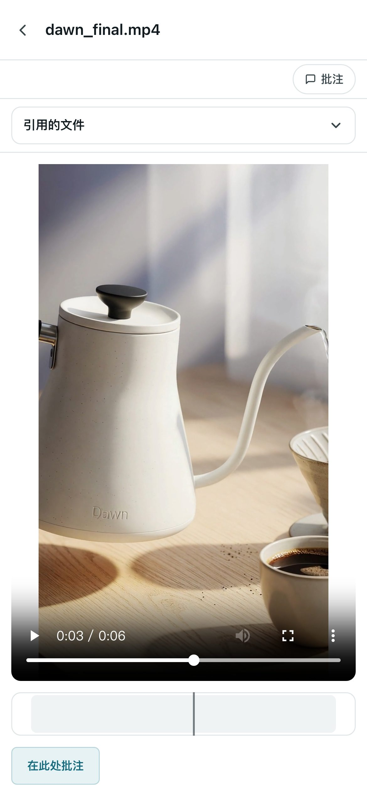

  
   
  另有 <a href="https://blackman99.github.io/deskfolk/media/deskfolk-reel-en.mp4">English</a> 版

<h1 align="center">Deskfolk</h1>

交出去，离开，回来看结果。

产物按件归好，在应用里直接播、直接看、直接批注；每一轮在做哪张任务、为什么，都画在流程图上，在哪个文件夹干的，任务地图上一步步回放；Bot 交付之后自己复盘，下次照做。 多天、多步、要返工的活也放心交：Bot 说做完的，应用先核过。

不一定要 API key：这台电脑上装好并登录的 <b>Claude Code、Codex、Grok、OpenCode、Antigravity、ZCode</b>，或任何讲 ACP 的 Agent，在向导里选它就能开始，用的是你自己的登录；项目会话里则直接和 Claude Code 或 Codex 对话，在你自己的文件夹里。 也可以接 <b>OpenAI、Anthropic、小米 MiMo、千问、DeepSeek、OpenRouter</b> 或任意 OpenAI / Anthropic 兼容地址，或本机的 <b>Ollama、LM Studio、llama.cpp</b>。

  <a href="https://blackman99.github.io/deskfolk/zh"><b>官网</b></a> ·
  <a href="https://github.com/Blackman99/deskfolk/releases/latest"><b>下载</b></a> ·
  <a href="docs/overview.zh.md"><b>介绍与安装</b></a> ·
  <a href="README.md">English</a>

  
  
  
  

   
  要不要先问你，按权限模式来

   
  说停就停，下一句接着做

   
  做完有定义：检查、审查和你的放行

   
  回来看结果：会话、成品、看板摆在一起

   
  活在哪儿干的：这件事画成一座文件夹小镇，一步步回放

   
  项目会话：在你的文件夹里直接用 Claude Code 或 Codex，和 Bot 在同一个窗口

  
  
  
   
  手机上也一样：会话、回答、这件事的检查、成片

<a href="docs/overview.zh.md">介绍与安装</a> · <a href="ROADMAP.md">路线图</a> · <a href="docs/development.md">开发说明</a> · <a href="CONTRIBUTING.md">参与贡献</a> · <a href="SECURITY.md">安全说明</a> · MIT

